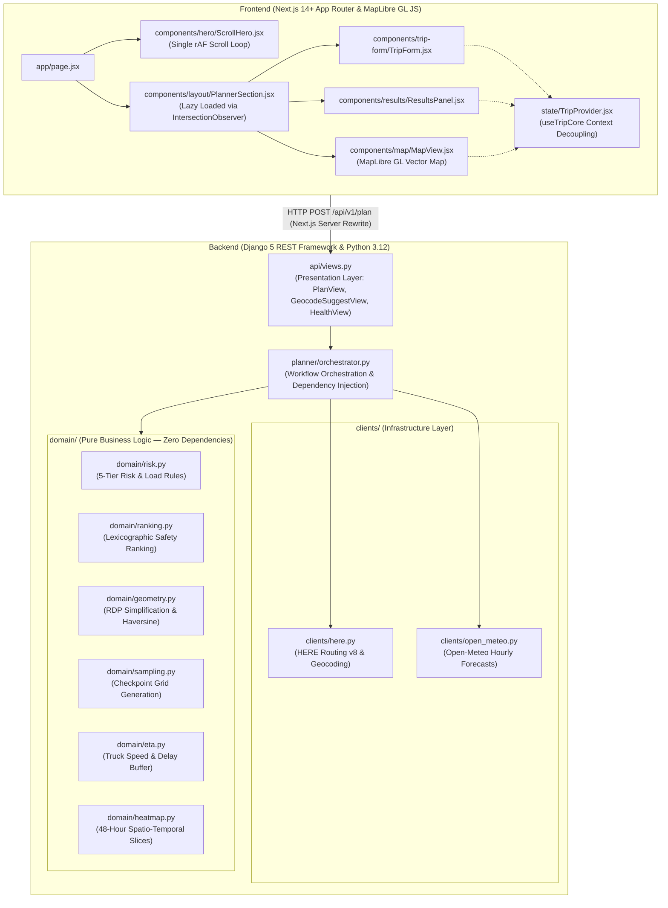

# HAULCAST — Weather-Aware Commercial Truck Route Planner

> **Live Frontend**: https://truck-route-finder-app.vercel.app  
> **Live Backend API**: https://truck-route-finder.vercel.app  
> **API Health Check**: https://truck-route-finder.vercel.app/api/v1/health

HAULCAST is an enterprise-grade commercial truck route planning application. It evaluates up to three viable commercial truck corridors, predicts weather conditions at the exact estimated time of arrival (ETA) for checkpoints every 10, 25, or 50 miles, assesses severe weather hazards against gross vehicle load weight, ranks routes using a strict safety-first lexicographic algorithm, and renders a 48-hour spatio-temporal weather heatmap at 60 frames per second.

The application opens with an editorial scroll-scrubbed hero narrative that introduces commercial freight weather hazards before seamlessly transitioning into the interactive planner.

---

## 1. Screenshots

| Section | Preview | Description |
| :--- | :--- | :--- |
| **Landing Hero** | *``* | Scroll-scrubbed interactive 3D video sequence with dynamic typography passing behind the truck cabin. |
| **Route Planner** | *``* | Dark-mode planner with worldwide geocoding autocompletion, departure timepicker, load weight input, and interval selector. |
| **Results & Comparison** | *``* | Side-by-side comparison of up to 3 truck routes, safety breakdown bars, recommended route banner, and checkpoint table. |
| **48-Hour Heatmap** | *``* | GPU-accelerated MapLibre GL heatmap layer with a zero-friction 0–48 hour slider scrubbing future weather movement. |

*(Replace placeholder paths in `docs/screenshots/` with actual captures upon live deployment).*

---

## 2. Architecture & Layering

The codebase strictly enforces unidirectional dependency layering. The `domain/` layer contains zero framework, HTTP, or database dependencies, allowing all mathematical and business logic to be tested deterministically in isolation.



---

## 3. Local Setup & Installation

### Prerequisites
* Python 3.12+
* Node.js 20+ and npm 10+
* A free [HERE Developer Platform API Key](https://developer.here.com/)

### 3.1 Backend Setup
```bash
# 1. Navigate to the backend directory
cd backend

# 2. Create and activate a Python virtual environment
python -m venv .venv
# On Windows PowerShell:
.\.venv\Scripts\Activate.ps1
# On macOS/Linux:
source .venv/bin/activate

# 3. Install production and development dependencies
pip install -r requirements.txt -r requirements-dev.txt

# 4. Copy environment configuration and edit with your HERE API key
cp .env.example .env
# Edit .env and paste your HERE_API_KEY

# 5. Start the Django development server
python manage.py runserver 8000
```
The backend API is now running at `http://127.0.0.1:8000/api/v1/health`.

### 3.2 Frontend Setup
```bash
# 1. Navigate to the frontend directory
cd frontend

# 2. Install Node dependencies
npm install

# 3. Copy environment configuration
cp .env.example .env.local

# 4. Start the Next.js development server
npm run dev
```
Open `http://localhost:3000` in your browser.

---

## 4. Environment Variables

### Backend (`backend/.env`)

| Variable | Default Value | Description |
| :--- | :--- | :--- |
| `DJANGO_SECRET_KEY` | `change-me` | Secret cryptographic signing key for Django. |
| `DJANGO_DEBUG` | `false` | Enable/disable debug mode (must be `false` in production). |
| `DJANGO_ALLOWED_HOSTS` | `localhost,127.0.0.1,.vercel.app` | Comma-separated allowed HTTP Host headers. |
| `CORS_ALLOWED_ORIGINS` | `http://localhost:3000` | Allowed origins for direct cross-origin browser requests. |
| `HERE_API_KEY` | *(Required)* | API Key from HERE Developer Platform for routing and geocoding. |
| `CACHE_BACKEND` | `locmem` | Django cache backend (`locmem` for in-memory, `redis` for external). |
| `REDIS_URL` | *Optional* | Connection URL if using Redis cache (e.g., `redis://localhost:6379/1`). |
| `DELAY_BUFFER` | `1.10` | 10% commercial truck duration buffer for stops and traffic delays. |
| `TRUCK_TARE_LB` | `32000` | Tare weight added to load weight for gross routing weight. |

### Frontend (`frontend/.env.local`)

| Variable | Default Value | Description |
| :--- | :--- | :--- |
| `BACKEND_URL` | `http://127.0.0.1:8000` | Backend API origin used by Next.js server rewrites to proxy `/api/*`. |
| `NEXT_PUBLIC_API_BASE_URL` | *(Empty string)* | Leave empty for same-origin Next.js rewrites; set only if issuing direct CORS requests. |
| `NEXT_PUBLIC_MAP_STYLE_URL` | `https://tiles.openfreemap.org/styles/positron` | MapLibre GL vector tile style (keyless Positron). |

---

## 5. Risk Engine & Lexicographic Ranking

For complete mathematical definitions, boundary rules, and worked examples, see **[docs/RISK_ENGINE.md](docs/RISK_ENGINE.md)**.

### 5-Tier Classification Hierarchy
1. `LOW` (1): Safe driving conditions.
2. `MODERATE` (2): Caution advised; minor slowdowns.
3. `HIGH` (3): Hazardous weather; increased rollover or braking risk.
4. `SEVERE` (4): Dangerous travel; high likelihood of road closures.
5. `NO_TRAVEL` (5): Extreme conditions; do not operate.

The final checkpoint risk is determined by the **worst of** wind, rain, and snow levels after load rules are applied.

### Load-Aware Wind Escalation
Empty or lightweight trailers are highly susceptible to crosswind blowovers:
* **`>40,000 lb` Rule**: If `load_weight_lb > 40,000`, a base Moderate wind (`25 ≤ wind < 35 mph`) escalates to **`HIGH`** due to braking instability and trailer sway.
* **`>30,000 lb` Rule**: If `load_weight_lb > 30,000`, a base High wind (`35 ≤ wind < 45 mph`) escalates to **`SEVERE`**.

### Lexicographic Recommendation
Routes are ranked deterministically by evaluating safety attributes in strict sequence (ascending):
$$\text{Rank Key} = (\text{No Travel miles}, \text{Severe miles}, \text{High miles}, \text{Mile-Weighted Average Risk}, \text{Travel Time})$$
A route with zero severe miles will always be recommended over a faster route that crosses dangerous blizzard or gale conditions.

---

## 6. Landing Hero & Media Customization

The landing page features a high-performance scroll-scrubbed hero component ([`ScrollHero.jsx`](frontend/src/components/hero/ScrollHero.jsx)):
* **Single `requestAnimationFrame` Loop**: Driven by [`useHeroScroll.js`](frontend/src/hooks/useHeroScroll.js). Starts only when the hero track is near the viewport via `IntersectionObserver` and terminates when scrolled past, preserving 0% CPU consumption while using the map.
* **Sticky Scene Mechanics**: Pinning duration is calculated based on viewport height and card strip length. Transforms and video `currentTime` seeks are throttled and guarded against concurrent seeking.
* **Typography Blend Trick**: The giant `SAFER ROUTES` typography utilizes `mix-blend-mode: darken` against the white vehicle footage, allowing the text to pass behind the truck cabin and shipping container without complex video masking.
* **Customizing Brand & Media**:
  All hero configuration is consolidated in [`frontend/src/components/hero/heroConfig.js`](frontend/src/components/hero/heroConfig.js):
  * **Brand Name**: Change `export const BRAND_NAME = "HAULCAST";`.
  * **Media URLs**: Update `MEDIA_CONFIG.video_1080p`, `MEDIA_CONFIG.video_720p`, or `MEDIA_CONFIG.poster` to your own CDN or self-hosted assets under `/public/media/`.

---

## 7. Testing Suite

### 7.1 Backend Tests & Linting
The backend test suite executes 223 unit and integration tests with **100% mocked network transports** (no live API calls made during tests):
```bash
# Run pytest across domain, client fixtures, orchestrator, and API endpoints
cd backend
pytest

# Run Ruff linter
ruff check .
```

### 7.2 Frontend Tests & Linting
The frontend test suite contains 130 tests covering state reducers, risk formatting, motion components, GeoJSON frame generation, and accessibility:
```bash
# Run Vitest test runner
cd frontend
npm test

# Run ESLint
npm run lint
```

---

## 8. Manual QA Verification Checklist

Verify before releasing or submitting:
- [ ] **Short Trip**: Plan a trip under 25 miles (e.g., Dallas to Fort Worth). Verify route renders and at least origin/destination checkpoints exist.
- [ ] **Cross-Country Trip**: Plan a 1,500+ mile trip (e.g., NYC to Dallas or Chicago to Seattle). Verify 3 distinct commercial routes appear.
- [ ] **Interval Selection**: Test switching between 10, 25, and 50-mile intervals. Verify checkpoint density adjusts accurately.
- [ ] **Heavy vs Light Load**: Run the same windy corridor at 25,000 lb vs 45,000 lb. Verify the `>40,000 lb` wind escalation rule fires on the heavier load.
- [ ] **Heatmap 60 FPS Slider**: Scrub the 0–48 hour slider continuously. Verify the map surface updates smoothly without frame drops or sidebar re-renders.
- [ ] **Responsive Viewports**: Test on mobile portrait (375px), tablet (768px), and desktop (1440px). Verify no horizontal scrollbars exist.
- [ ] **Reduced Motion**: Enable `prefers-reduced-motion` in OS or browser DevTools. Verify hero video scrubbing is instantaneous, route animations are skipped, and all content renders in final settled states.
- [ ] **Error Handling**: Test with network disconnected or invalid origin. Verify the `ErrorPanel` presents a clear, actionable error message.

---

## 9. Known Limitations

In compliance with project specifications, the following architectural boundaries are stated transparently:
1. **Linear ETA Interpolation**: Checkpoint ETAs are estimated using total buffered truck duration distributed linearly across cumulative distance. Localized urban traffic fluctuations and non-linear speed variations are not modeled.
2. **Hours of Service (HOS)**: Federal Motor Carrier Safety Administration (FMCSA) mandatory 30-minute breaks and 10-hour sleeper berth off-duty periods are not modeled.
3. **Forecast Resolution**: Weather conditions are sampled at hourly intervals on Open-Meteo's weather-model grid (~1–10 km spatial resolution). Rapid micro-climate shifts between hours are interpolated.
4. **API Rate Limits**: The Open-Meteo free tier is restricted to non-commercial evaluation (~10,000 calls/day), and HERE platform freemium transactions apply.
5. **Serverless Cache Isolation**: In-memory `LocMemCache` is local to each serverless container instance on Vercel. Shared corridor caching across distributed lambdas requires an external Redis instance.
6. **Hero Media Assets**: Hero background video and poster rely on static CloudFront CDN endpoints specified in the design spec.
7. **Commercial Truck Load Limits**: The maximum load limit is enforced at 80,000 lb (`MAX_LOAD_LB = 80,000`), following the US legal gross vehicle maximum weight sanity threshold. While routing is supported worldwide, regional weight classifications and limits in other jurisdictions may differ.
8. **International Truck Routing Coverage**: Commercial truck road attributes (such as height/weight clearances, truck turn restrictions, and hazardous material rules) are provided by HERE Routing API v8, and data density varies across international road networks.

---

## 10. Credits & Attribution

* **[HERE Technologies](https://developer.here.com/)**: Commercial truck routing via HERE Routing API v8 and location autocomplete via HERE Geocoding & Search API v7.
* **[Open-Meteo](https://open-meteo.com/)**: Hourly weather forecasts, wind speed, precipitation, and snowfall depth under CC BY 4.0.
* **[OpenFreeMap](https://openfreemap.org/)**: Keyless Positron vector map styles and vector tiles.
* **[OpenStreetMap Contributors](https://www.openstreetmap.org/)**: Global basemap cartographic data (ODbL).
